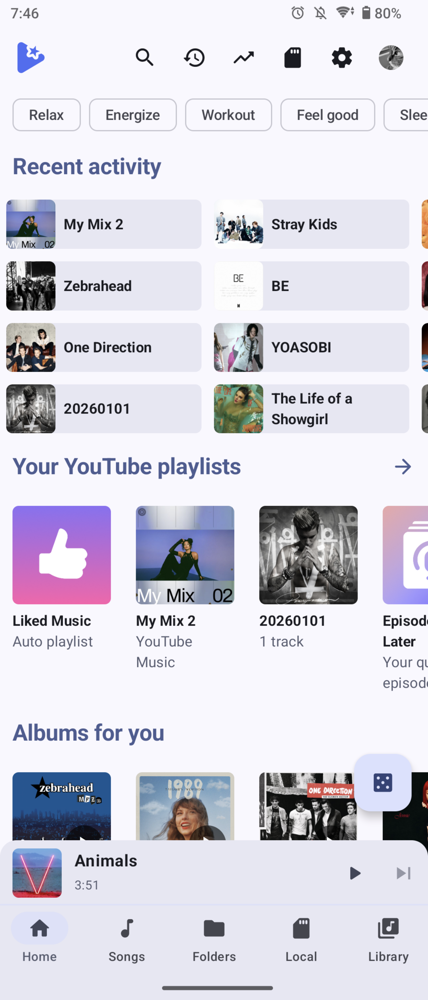
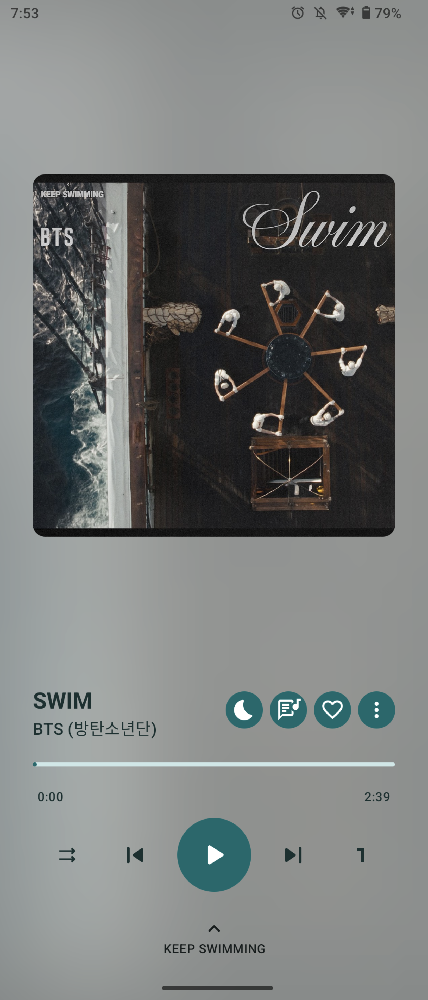
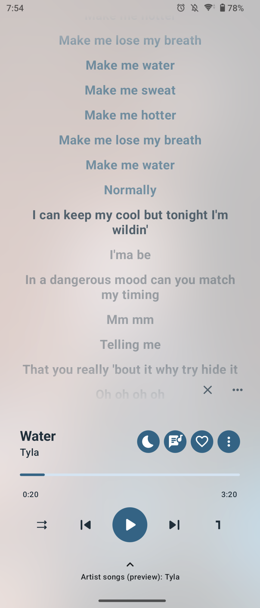
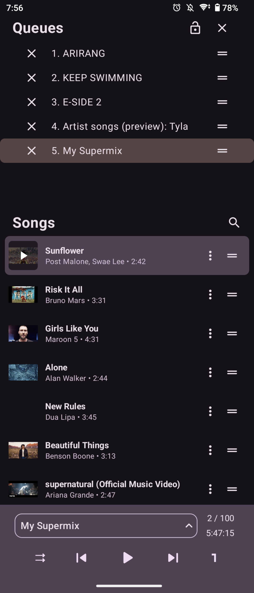
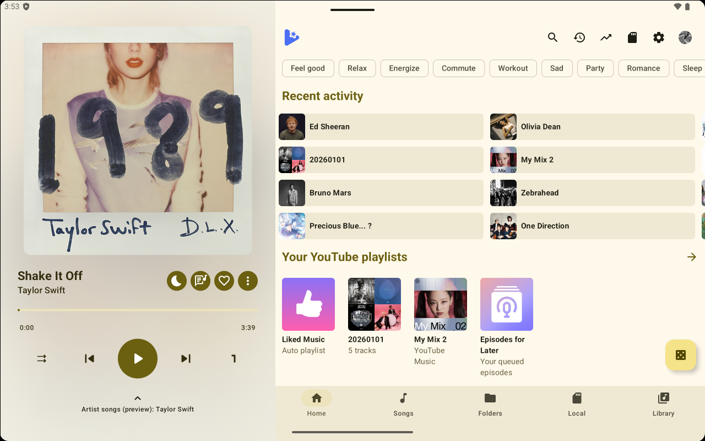
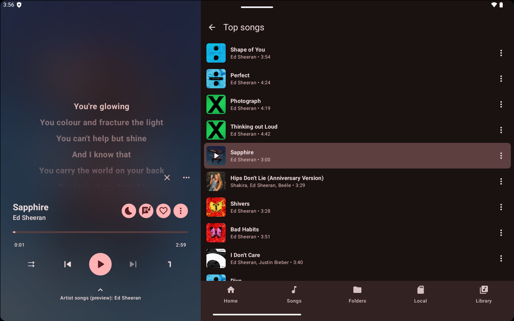
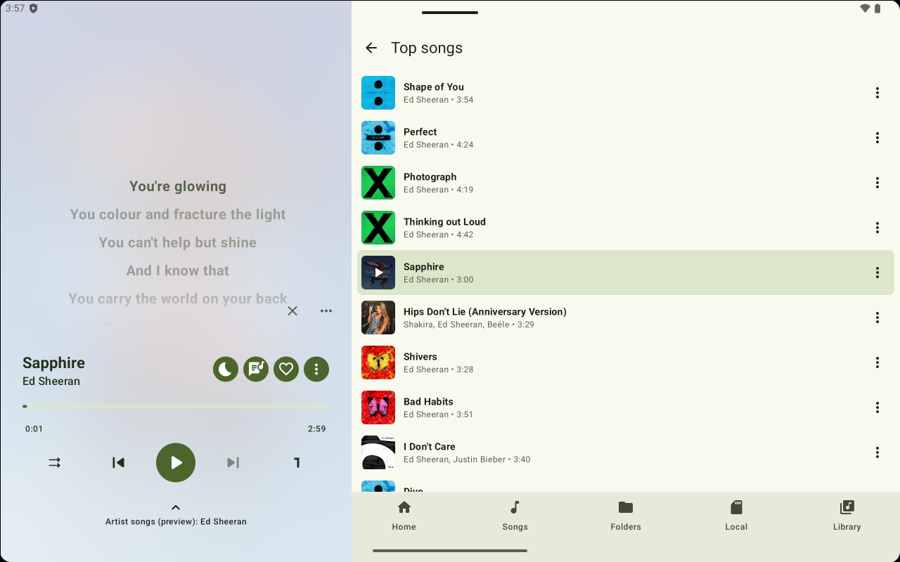
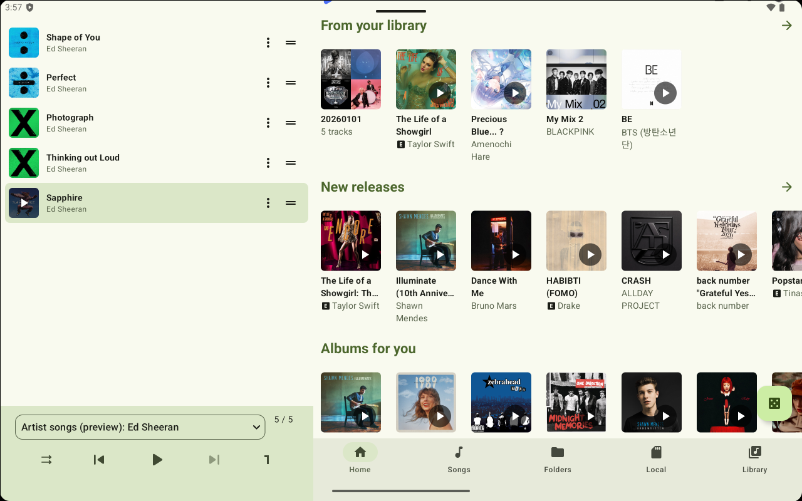

<p align="center">
  
</p>

<h1 align="center">AsterTune</h1>

<p align="center">
  <b>A Material Design 3 YouTube Music client and local media player for Android</b>
</p>

<p align="center">
  <a href="https://github.com/yuuichi-s/AsterTune/releases"></a>
  <a href="https://www.gnu.org/licenses/gpl-3.0"></a>
  <a href="https://hosted.weblate.org/projects/yuuichi-s-astertune/"></a>
</p>

<p align="center">
  <a href="https://github.com/yuuichi-s/AsterTune/releases/latest"></a>
</p>

<p align="center">
  <a href="README.md">English</a> · <a href="README_ja.md">日本語</a>
</p>

<p align="center">
  <a href="#-overview" style="color: #58a6ff;">Overview</a> ·
  <a href="#-features" style="color: #58a6ff;">Features</a> ·
  <a href="#-migrating-from-outertune-to-astertune" style="color: #58a6ff;">Migration</a> ·
  <a href="#-improvements-in-this-fork" style="color: #58a6ff;">Improvements</a> ·
  <a href="#-screenshots" style="color: #58a6ff;">Screenshots</a> ·
  <a href="#-submitting-translations" style="color: #58a6ff;">Translations</a> ·
  <a href="#-building-from-source" style="color: #58a6ff;">Build</a>
</p>

---

## 📌 Overview

**AsterTune** is an Android application based on [OuterTune](https://github.com/OuterTune/OuterTune).<br />
Built with Material Design 3, it combines the functionality of a local media player and a YouTube Music client.

To transfer your data from OuterTune, see [Migrating from OuterTune to AsterTune](#migrating-from-outertune-to-astertune).

---

## ✨ Features

| 🎵 YouTube Music | 🎧 Local Music Playback |
| :--- | :--- |
| • Seamless playback with no ads & background play<br>• Synchronization with your YouTube Music account library<br>• Song downloads for offline playback | • Audio playback (`MP3, OGG, FLAC, ALAC`)<br>• Custom metadata extraction (reads multi-value & specialized tags)<br>• Combined queue for local & YouTube Music songs<br>• **Android Auto** support |

| 🎤 Lyrics | ⚙️ Customization & Extras |
| :--- | :--- |
| • Synced lyrics (including word-level `LRC` and `TTML`)<br>• Sources: `LrcLib, KuGou, SimpMusic, BetterLyrics`, YouTube captions<br>• Parallel queries for enabled lyrics sources<br>• Built-in lyrics import & editing | • Dynamic Material Design 3 UI<br>• Offline & Wi-Fi download management<br>• Advanced local audio normalization & metadata extraction |

---

## 🔄 Migrating from OuterTune to AsterTune

You can transfer your data using the app's built-in backup feature.

> [!NOTE]
> Backups include the library database and app settings. Downloaded audio files are not included, so you will need to download them again after restoring the backup.

1. In **OuterTune**, open **Settings → Backup and Restore**, tap **Backup**, and save the backup file.
2. In **AsterTune**, open **Settings → Backup and Restore**, tap **Restore**, and select the backup file you saved.

---

## 🛠️ Improvements in This Fork

<details>
<summary><b>Click to expand full changelog (Based on OuterTune v0.10.1)</b></summary>

### YouTube Music Playback and Display
- Fixed issues with missing album tracks, crashes when viewing playlists, and failures when retrieving search results
- Resolved the “Source error 2004” issue that prevented YouTube Music playback
- Improved thumbnail image resolution
- Fixed a crash that could occur when opening a playlist or album while its data was being updated
- Fixed crashes when importing m3u playlists and improved matching with YouTube songs

### Lyrics
- Improved lyrics retrieval accuracy and display speed using LrcLib and caption tracks
- Added a lyrics toggle button to the playback screen's action bar
- Added SimpMusic and BetterLyrics as lyrics providers
- Queries enabled providers in parallel with timeouts
- Retrieves lyrics through the playback service even while the lyrics panel is closed

### App Navigation and Menus
- Adjusted bottom navigation to make switching tabs and re-tapping the active tab feel more natural
- Fixed issues with the search bar, sorting, and list refreshes on the Folders screen
- Replaced the persistent search bar at the top of tab screens with a row of icons for search, history, statistics, settings, and other actions
- Added the ability to swipe left or right on the mini player to move to the previous or next song

### Local Music Playback
- Improved metadata reading, link handling, and gapless playback for local songs
- Fixed an incorrect song count on album screens
- Added a Local tab for browsing on-device songs, albums, artists, and playlists with filtering and search
- Added audio normalization for local songs, which evens out volume between songs based on loudness measured during playback (off by default)

### Display and Settings
- Improved the tablet UI
- Added support for small devices with a landscape screen, such as an Echo Show 5 running LineageOS, by moving the navigation bar to the left edge of the screen and showing the player in the landscape layout
- Automatically detects the system contrast setting on Android 14 and later
- Added custom accent colors
- Added a player setting to keep audio focus
- Added cards showing recent YouTube Music activity on the Home screen when signed in
- Added the current queue name to the handle used to open the player's queue
- Replaced the account icon with the signed-in account's profile image
- Reorganized the Settings screen by merging Appearance and Interface into “Appearance and Controls” and adding Privacy as a top-level section

### Playback and Downloads
- Added a sleep timer that fades out and stops playback completely
- Added a toggle to download only when connected to Wi-Fi

</details>

---

## 📱 Screenshots

<details open>
<summary><b>Smartphone</b></summary>
<br>

| Home | Player | Lyrics | Queue |
| :---: | :---: | :---: | :---: |
|  |  |  |  |

</details>

<details>
<summary><b>Landscape & Tablet Layouts</b></summary>
<br>

### Landscape
| Home | Player |
| :---: | :---: |
|  |  |

### Tablet
| Home | Lyrics (Dark) |
| :---: | :---: |
|  |  |

| Lyrics (Light) | Queue |
| :---: | :---: |
|  |  |

</details>

---

## 🌍 Submitting Translations

We use **Weblate** to translate AsterTune. For more details or to submit translations, visit our [Weblate page](https://hosted.weblate.org/projects/yuuichi-s-astertune/).

<p align="center">
  <a href="https://hosted.weblate.org/projects/yuuichi-s-astertune/">
    
  </a>
</p>

---

## 🤝 Credits & Special Thanks

### Credits
| Project | Description |
| :--- | :--- |
| [OuterTune](https://github.com/OuterTune/OuterTune/) | Upstream project |
| [InnerTune](https://github.com/z-huang/InnerTune) | Original foundation of OuterTune |

### Special Thanks
| Project | Description |
| :--- | :--- |
| [Musicolet](https://play.google.com/store/apps/details?id=in.krosbits.musicolet) | Inspiration for the local media player experience |
| [Gramophone](https://github.com/FoedusProgramme/Gramophone) | Lyrics parser and ALAC decoder |

---

## 🏗️ Building from Source

```bash
# Core
./gradlew assembleCoreDebug

# Full
./gradlew assembleFullDebug
```

---

## ⚖️ Disclaimer

This project and its contents are not affiliated with, funded, authorized, or endorsed by YouTube, Google LLC, or any of their affiliates or subsidiaries.

Any trademarks, service marks, trade names, or other intellectual property rights used in this project belong to their respective owners.
