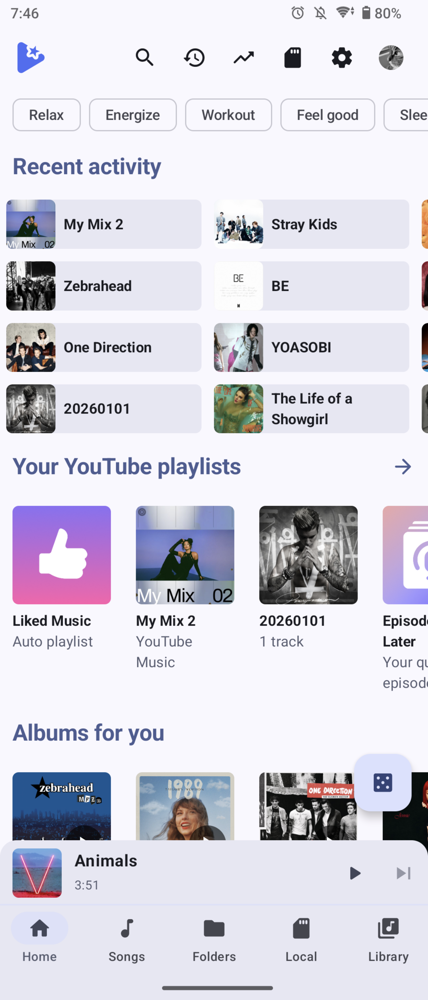
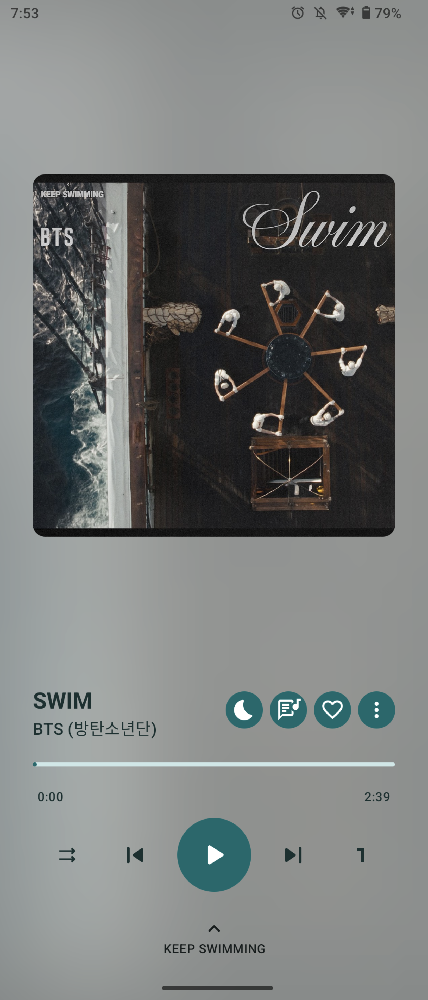
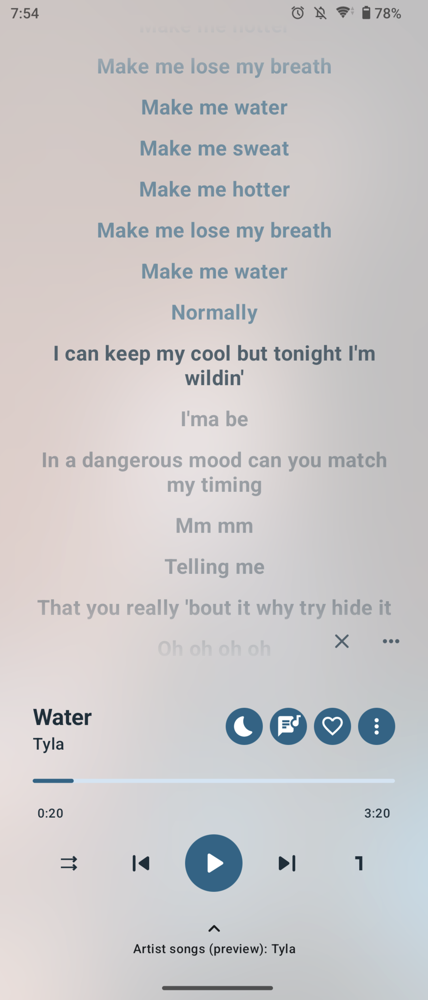
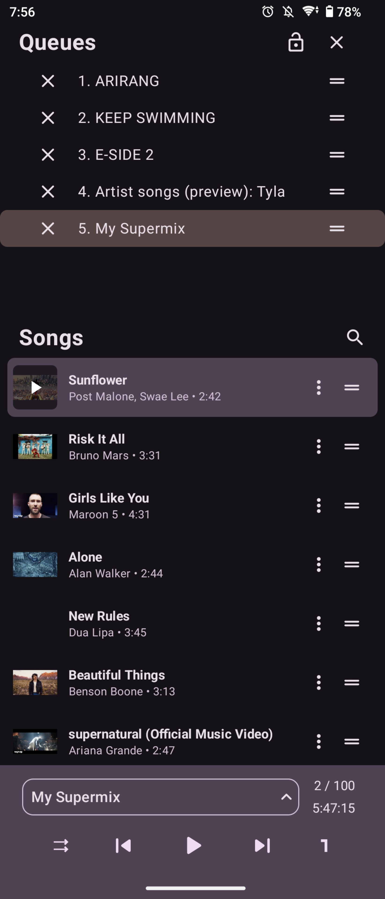
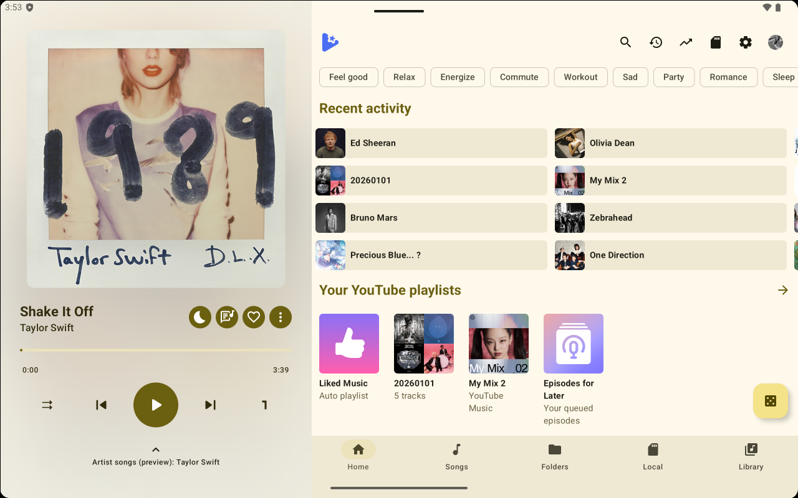
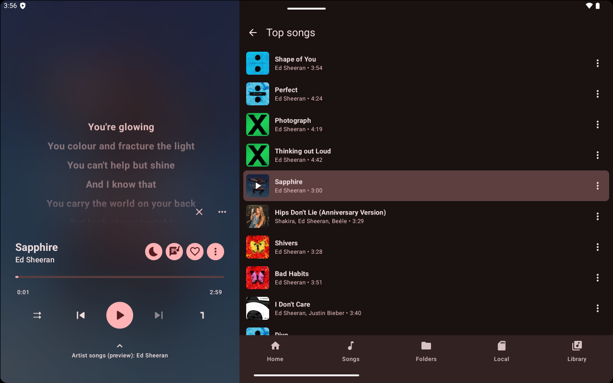
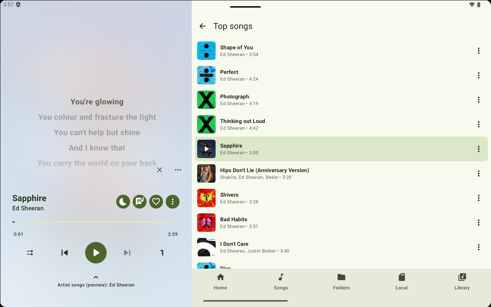
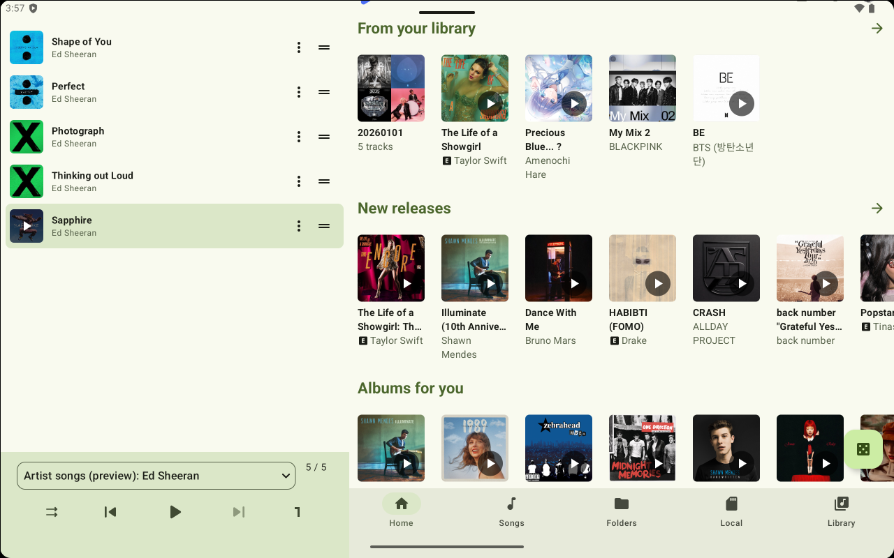

<p align="center">
  
</p>

<h1 align="center">AsterTune</h1>

<p align="center">
  <b>Android向けMaterial Design 3採用のYouTube Music クライアント & ローカルメディアプレイヤー</b>
</p>

<p align="center">
  <a href="https://github.com/yuuichi-s/AsterTune/releases"></a>
  <a href="https://www.gnu.org/licenses/gpl-3.0"></a>
  <a href="https://hosted.weblate.org/projects/yuuichi-s-astertune/"></a>
</p>

<p align="center">
  <a href="https://github.com/yuuichi-s/AsterTune/releases/latest"></a>
</p>
<!--
[](https://github.com/yuuichi-s/AsterTune/releases/latest)
[](https://f-droid.org/packages/io.github.yuuichi_s.astertune/)
[](https://apt.izzysoft.de/fdroid/index/apk/io.github.yuuichi_s.astertune)
-->

<p align="center">
  <a href="README.md">English</a> · <a href="README_ja.md">日本語</a>
</p>

<p align="center">
  <a href="#-概要" style="color: #58a6ff;">概要</a> ·
  <a href="#-機能" style="color: #58a6ff;">機能</a> ·
  <a href="#-outertuneからastertuneへの移行" style="color: #58a6ff;">移行手順</a> ·
  <a href="#-このフォークで改善していること" style="color: #58a6ff;">改善点</a> ·
  <a href="#-スクリーンショット" style="color: #58a6ff;">スクリーンショット</a> ·
  <a href="#-翻訳" style="color: #58a6ff;">翻訳</a> ·
  <a href="#-ソースからのビルド" style="color: #58a6ff;">ビルド</a>
</p>

---

## 📌 概要

**AsterTune**は、[OuterTune](https://github.com/OuterTune/OuterTune)をベースとするAndroidアプリケーションです。<br />
Material Design 3を採用し、ローカルメディアプレーヤーとYouTube Musicクライアントの両方の機能を備えています。

OuterTuneのデータを移行する場合は[OuterTuneからAsterTuneへの移行](#-outertuneからastertuneへの移行)をご覧ください。

---

## ✨ 機能

| 🎵 YouTube Music | 🎧 ローカル音楽ファイル再生 |
| :--- | :--- |
| • YouTube Musicの楽曲をシームレスに再生（広告なし & バックグラウンド再生）<br>• YouTube Musicのアカウントに紐づくライブラリを同期<br>• 楽曲のダウンロード（オフライン再生） | • 端末内の音声ファイル（`MP3`、`OGG`、`FLAC`、`ALAC`等）の再生<br>• タグの読み取りにMediaStoreではなく独自の抽出処理を使用し、複数値タグや特殊なタグも正しく読み取り<br>• ローカルの曲とYouTube Musicの曲を同じキューで再生<br>• **Android Auto** 対応 |

| 🎤 歌詞 | ⚙️ カスタマイズ・その他 |
| :--- | :--- |
| • 同期歌詞に対応。`LRC` や `TTML` など単語単位の形式も表示<br>• `LrcLib`、`KuGou`、`SimpMusic`、`BetterLyrics`、YouTube の字幕トラックから歌詞を取得<br>• 使用する取得元を選択可能。有効な取得元には並行して問い合わせ<br>• 歌詞の取り込みと編集 | • ダイナミックカラーに対応したMaterial Design 3 UI<br>• オフライン再生用のダウンロード管理とWi-Fi接続時のみのダウンロード<br>• ローカル音声の正規化と詳細なメタデータ抽出 |

---

## 🔄 OuterTuneからAsterTuneへの移行

アプリ内のバックアップ機能を使用することでデータを引き継ぐことが可能です。

> [!NOTE]
> バックアップには、ライブラリデータベースとアプリの設定が含まれています。ダウンロードしたオーディオファイルは含まれていないため、復元後はダウンロードを再度行う必要があります。

1. **OuterTune** で **設定 → バックアップと復元** を開き、**バックアップ** をタップし、バックアップファイルを保存します。
2. **AsterTune** で **設定 → バックアップと復元** を開き、**復元** をタップし、保存しておいたバックアップファイルを選択します。

---

## 🛠️ このフォークで改善していること

<details>
<summary><b>OuterTune v0.10.1をベースに、YouTube Music の再生安定性、歌詞表示、操作性、ローカル音楽再生まわりを中心に改善しています。</b></summary>

### YouTube Music の再生・表示
- アルバムの楽曲が表示されない問題、プレイリスト表示時のクラッシュ、検索結果の取得失敗などを修正
- YouTube Music の再生を妨げる「Source error 2004」を解消
- サムネイル画像の解像度を改善
- プレイリストやアルバムを開く際、データの更新中に起こり得たクラッシュを修正
- m3u プレイリストの取り込み時のクラッシュを修正し、YouTube 楽曲との照合を改善

### 歌詞表示
- LrcLib とキャプショントラックを利用し、歌詞取得の精度と表示速度を改善
- 再生画面の操作バーに歌詞切替ボタンを追加
- SimpMusic と BetterLyrics を歌詞プロバイダーとして追加
- 有効なプロバイダーへタイムアウト付きで並列に問い合わせ
- 歌詞パネルを閉じている間も再生サービスで歌詞を取得

### アプリの操作とメニュー
- ボトムナビゲーションの挙動を調整し、タブ移動や再タップ時の動作を自然に変更
- フォルダー画面の検索バー、並び順、リスト更新の問題を修正
- タブ画面上部に常時表示していた検索バーを、検索・履歴・統計・設定などをまとめたアイコン列に変更
- ミニプレーヤーを左右にスワイプして前後の曲へ移動する操作を追加

### ローカル音楽再生
- ローカル楽曲のタグ読み取り、リンク処理、ギャップレス再生を改善
- アルバム画面に表示される楽曲数の誤りを修正
- 端末内の楽曲・アルバム・アーティスト・プレイリストを、絞り込みと検索で閲覧できる「ローカル」タブを追加
- ローカル楽曲に、曲ごとの音量差をそろえるオーディオの正規化を追加（再生時に音量を測定。初期設定はオフ）

### 表示・設定
- タブレット向けUIを改善
- LineageOS を導入した Echo Show 5 など、横長の画面を持つ小型端末に対応。ナビゲーションバーを画面の左端に移し、プレイヤーを横向きのレイアウトで表示
- Android 14 以降ではシステムのコントラスト設定を自動検出
- カスタムアクセントカラーを追加
- 「オーディオフォーカスを維持」するプレイヤー設定を追加
- サインイン時、ホーム画面に YouTube Music の最近のアクティビティをカード表示で追加
- プレイヤーのキューを開くハンドルに現在のキュー名を表示
- アカウントアイコンを、サインイン中のアカウントのプロフィール画像に変更
- 設定画面を再編し、「外観」と「インターフェイス」を「外観と操作」に統合、「プライバシー」を最上位に追加

### 再生・ダウンロード
- フェードアウトして再生を完全に停止する睡眠タイマーを追加
- Wi-Fi 接続時のみダウンロードするトグルを追加

</details>

---

## 📱 スクリーンショット

<details open>
<summary><b>スマートフォン</b></summary>
<br>

| ホーム | プレイヤー | 歌詞 | キュー |
| :---: | :---: | :---: | :---: |
|  |  |  |  |

</details>

<details>
<summary><b>横画面・タブレットのレイアウト</b></summary>
<br>

### 横画面
| ホーム | プレイヤー |
| :---: | :---: |
|  |  |

### タブレット
| ホーム | 歌詞（ダーク） |
| :---: | :---: |
|  |  |

| 歌詞（ライト） | キュー |
| :---: | :---: |
|  |  |

</details>

---

## 🌍 翻訳

AsterTuneの翻訳には**Weblate**を使用しています。詳細や翻訳の投稿については、[Weblateのページ](https://hosted.weblate.org/projects/yuuichi-s-astertune/)をご覧ください。

<p align="center">
  <a href="https://hosted.weblate.org/projects/yuuichi-s-astertune/">
    
  </a>
</p>

---

## 🤝 Credits & Special Thanks

### Credits
| Project | Description |
| :--- | :--- |
| [OuterTune](https://github.com/OuterTune/OuterTune/) | Upstream project |
| [InnerTune](https://github.com/z-huang/InnerTune) | Original foundation of OuterTune |

### Special Thanks
| Project | Description |
| :--- | :--- |
| [Musicolet](https://play.google.com/store/apps/details?id=in.krosbits.musicolet) | ローカルメディアプレーヤー体験 |
| [Gramophone](https://github.com/FoedusProgramme/Gramophone) | 歌詞パーサー、ALAC デコーダー |

---

## 🏗️ ソースからのビルド

```bash
# Core
./gradlew assembleCoreDebug

# Full
./gradlew assembleFullDebug
```

手順の詳細は [CONTRIBUTING.md](CONTRIBUTING.md) をご覧ください。

> [!NOTE]
> Markdownドキュメントは順次メンテナンスします。

---

## ⚖️ 免責事項

本プロジェクトおよびその内容は、YouTube、Google LLC またはその関連会社・子会社と一切関係なく、資金提供、承認、推薦も受けていません。

本プロジェクトで使用されている商標、サービスマーク、商号、その他の知的財産権はそれぞれの権利者に帰属します。
